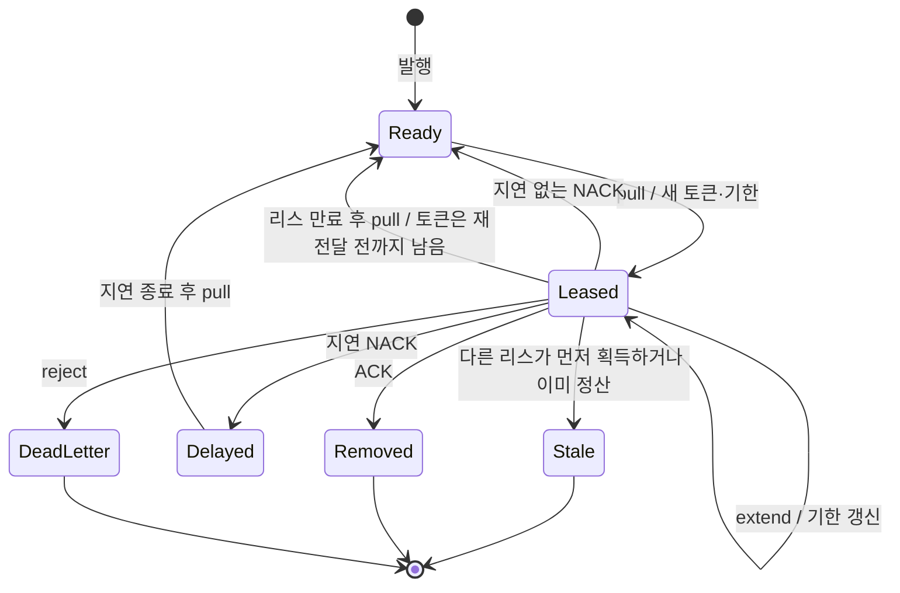

# Potato Pyramid 검증 증거 리뷰

대표 PR [#219](https://github.com/ppzxc/smq/pull/219)의 커밋 `ec5715d`에서 확인한 결과다.

## 리스·정산 상태와 대표 테스트

| 전이·불변식 | 대표 테스트 |
| --- | --- |
| 리스 만료 뒤 재전달과 전달 횟수 증가 | `SmqConformanceTest.리스가_만료된_메시지는_원래_id_자리로_돌아가_다시_꺼내지고_전달_횟수가_늘어난다` |
| 만료 직후 재꺼내기 전까지 이전 리스의 정산이 허용됨 | `SmqConformanceTest.기한이_지났어도_아무도_다시_꺼내지_않았다면_원래_리스의_정산과_연장은_OK다` |
| 지연 없는 NACK은 준비 상태로 복귀 | `SmqConformanceTest.지연_없이_NACK한_메시지는_자기_id_자리로_돌아가_다음_꺼내기에서_먼저_나온다` |
| 혼합 ACK/NACK 정산은 원자적 | `SmqConformanceTest.섞인_정산은_원자적이라_중간_상태가_다른_꺼내기에_보이지_않는다` |
| 이전 청크의 반복 정산은 STALE | `SmqConformanceTest.정산된_메시지에_같은_리스로_다시_정산하면_NACK도_STALE이다` |
| reject의 dead-letter 이동과 원본 메타데이터 보존 | `SmqConformanceTest.reject한_메시지는_dead_letter_큐로_옮겨지고_payload와_헤더를_유지하며_smq_헤더를_갖는다` |
| 실제 동시 만료·연장 경합의 허용 결과 | `SmqConformanceTest.만료된_리스를_연장하는_쪽과_다시_꺼내는_쪽이_동시에_겨루면_한_쪽만_성공한다` |
| 독립 모델 대조와 최소 만료 반례 | `LeaseCounterexampleTest.만료_정각_변이는_원본과_축소_명령열에서_같은_차이를_낸다` |

## 대표 PR 증거

2026-11-25에 #219의 동일 SHA에서 다음 필수 검사 네 개가 모두 성공했다.

| 검사 | 결과 | 실행 |
| --- | --- | --- |
| `linux-build` | 성공, 2분 37초 | [Linux run](https://github.com/ppzxc/smq/actions/runs/45531669122) |
| `linux-deploy-test` | 성공, 1분 20초 | [Linux run](https://github.com/ppzxc/smq/actions/runs/45531669122) |
| `windows-build` | 성공, 4분 58초 | [Windows run](https://github.com/ppzxc/smq/actions/runs/45531669116) |
| `windows-deploy-test` | 성공, 1분 35초 | [Windows run](https://github.com/ppzxc/smq/actions/runs/45531669116) |

실행 후 `Protect main` 규칙 세트는 위 네 job 이름을 필수 상태로 요구하며 우회 목록은 비어 있다. 릴리스 gate는 같은 SHA의 Linux·Windows 워크플로에서 이 네 job을 조회한다. 누락 시험 PR [#220](https://github.com/ppzxc/smq/pull/220)은 나머지 검사 통과 후에도 필수 `windows-build`가 없어서 BLOCKED였고, 실패 시험 PR [#221](https://github.com/ppzxc/smq/pull/221)은 `linux-build` 실패로 BLOCKED였다. 두 임시 PR은 확인 후 닫았다. 대표 PR은 네 필수 검사 모두 성공해 CLEAN이었다. 대표 실행에 첫 실패 아티팩트는 없었으며, 실패 재현 경로는 Linux workflow의 smoke 실패 업로드 및 동일 시드 재실행으로 검증한다.

## 정형 검증과 자동화 범위

현재 자동화는 두 저장소의 공통 계약, 가상 시계 상태 전이, 동시 호출 테스트, SQLite 실제 파일·트랜잭션 경계를 사용한다. #210의 `LeaseCounterexampleTest`는 독립 리스 모델과 `publish → pull → deadline → pull` 명령열을 대조하며, 한 단계를 제거하면 차이가 사라지는 최소 반례를 확인한다. 메모리 만료 비교를 `<`로 바꾼 변이는 13건, SQLite 비교 변이는 26건의 테스트 실패를 만들었고, 원복 후 대상 테스트가 통과했다. PR #219의 이 SHA에는 모델 테스트가 포함되어 있다. 전체 `./gradlew check`는 Linux 2분 37초, Windows 4분 58초였다. Linux 모델·계약 테스트 자체는 Java 25에서 28.04초였다. Windows 수치는 모델 테스트만 분리한 시간이 아니라 전체 검사 잡 시간이다.

이 증거는 경계 조건 회귀를 재현하고 잡아내지만 모든 명령열을 증명하지는 않는다. 추가 정형 검증 도구는 현재 최소 반례가 축소되고 표적 변이가 검출되는 동안에는 보류한다. 새 미해결 반례가 나오거나 반례 축소·검토 비용이 현재 테스트 비용을 넘으면 TLA+ 등의 도입을 다시 검토한다.
